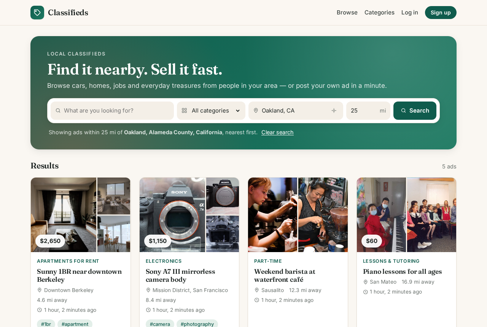
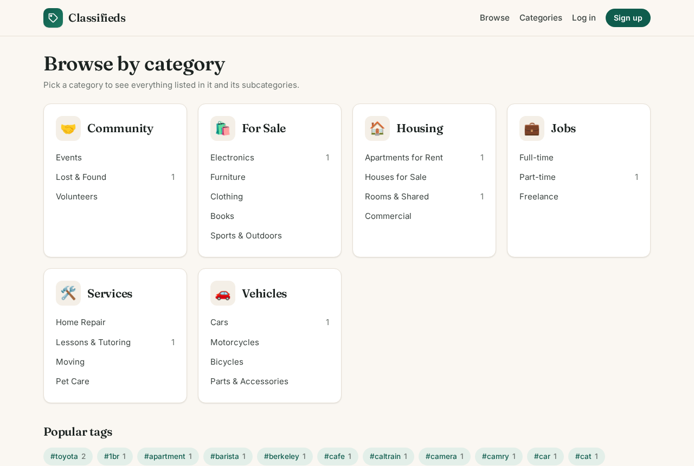
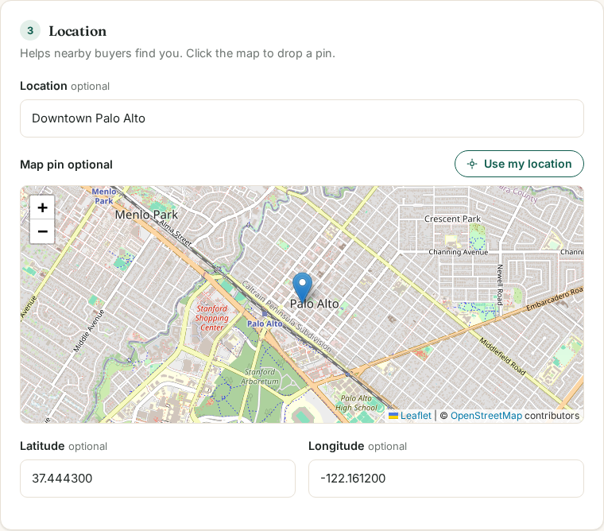
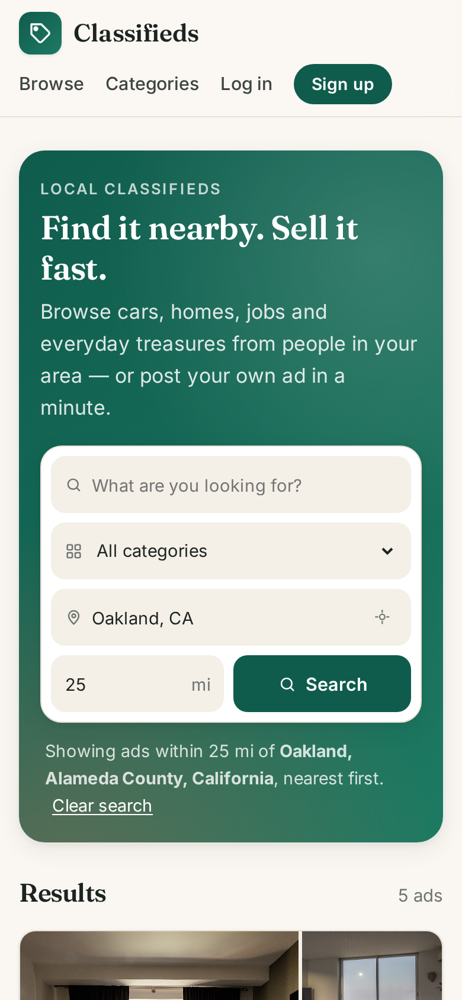

# Classifieds

A simple classified-ads site built with Python and Django.

## Features

- **Post ads** with title, description, price, category, tags and location
- **Browse ads**: latest ads, full-text search, pagination
- **Categories and subcategories**: browsing a category includes its subcategories' ads
- **Tags**: comma-separated tags on each ad, with a page per tag and a popular-tags list
- **Geolocation**: pick a spot on a map (or use your browser's location) when posting; find ads near you or near any place you type (city, neighborhood or ZIP code, looked up with OpenStreetMap) within a radius in miles, sorted by distance; each ad shows a map
- **User accounts**: sign up, log in and log out
- **Delete your account** (password confirmation; deletes all your ads too)
- **Delete your ads** (owners only)
- **Light and dark themes**: a switch in the header (sun/moon), remembered in a cookie; until you choose, the site follows your system setting
- **Privacy Policy and Terms of Use** pages, with a signup consent checkbox (18+) recorded per Terms version; see [docs/compliance.md](docs/compliance.md)
- **Messages**: buyers message sellers from an ad page; both get an inbox with unread counts and a private conversation per ad. Emails are never shown.

Maps use [Leaflet](https://leafletjs.com/) with OpenStreetMap tiles.

## Screenshots

**Home page: search by place name and radius**, nearest first



**Ad page** with a photo grid (click to open the lightbox) and a map of the location


| Browse by category | Posting an ad: drop a pin on the map |
|---|---|
|  |  |

**On a phone**



Demo listing photos are from Wikimedia Commons under their own licences, and maps are © OpenStreetMap contributors. See [docs/screenshots/CREDITS.md](docs/screenshots/CREDITS.md).

## Getting started

```bash
python3 -m venv .venv
source .venv/bin/activate
pip install -r requirements.txt
export DJANGO_DEBUG=1                # local development (or use the Makefile: make setup, make run)
python manage.py migrate
python manage.py seed_categories     # starter categories and subcategories
python manage.py seed_ads            # optional: demo ads around the SF Bay Area, with photos
python manage.py createsuperuser     # optional, for /admin/
python manage.py runserver
```

Then open http://127.0.0.1:8000/.

## Running tests

```bash
python manage.py test
```

## Configuration

Settings are read from environment variables. They **fail safe**: debug mode is off unless you turn it on, and without debug mode the site refuses to start until you set a real secret key.

| Variable | Default | Notes |
| --- | --- | --- |
| `DJANGO_DEBUG` | `0` | `1` for local development only (the Makefile sets it) |
| `DJANGO_SECRET_KEY` | none | Required when `DJANGO_DEBUG` is not `1` |
| `DJANGO_ALLOWED_HOSTS` | `localhost,127.0.0.1` | Comma-separated host names |
| `DJANGO_CSRF_TRUSTED_ORIGINS` | none | e.g. `https://classifieds.example.com` |
| `DJANGO_BEHIND_PROXY` | `0` | `1` when a reverse proxy sets `X-Forwarded-For` / `X-Forwarded-Proto` |
| `DJANGO_REDIS_URL` | none | Use Redis as the shared cache instead of files in `.cache/` |
| `DJANGO_CACHE_DIR` | `.cache/` | Location of the file cache |
| `DJANGO_SSL_REDIRECT` | `1` | Redirect HTTP to HTTPS when not in debug mode |
| `DJANGO_HSTS_SECONDS` | 30 days | `Strict-Transport-Security` max-age |
| `DJANGO_HSTS_SUBDOMAINS` | `0` | Only if every subdomain is HTTPS-only |
| `DJANGO_SITE_OPERATOR` | none | Who runs the site, shown in the Privacy Policy and Terms |
| `DJANGO_SITE_CONTACT_EMAIL` | none | Address for privacy, legal and abuse requests |
| `DJANGO_DMCA_AGENT` | none | DMCA agent name and address registered with the US Copyright Office |

## Deploying

The app is ready for a public deployment once these are in place:

1. **Settings:** set `DJANGO_SECRET_KEY` (e.g. `python -c "import secrets; print(secrets.token_urlsafe(50))"`), `DJANGO_ALLOWED_HOSTS` and `DJANGO_CSRF_TRUSTED_ORIGINS`, and leave `DJANGO_DEBUG` unset. Run `python manage.py check --deploy`.
2. **Database and photos:** `python manage.py migrate`, then `python manage.py reprocess_images` once if the database has photos uploaded before metadata stripping existed.
3. **Static files:** `python manage.py collectstatic` and serve `staticfiles/` at `/static/` with a long cache lifetime: in production, file names include a content hash (`site.b512ad0df5b7.css`), so updates always get new URLs. Everything (Leaflet, fonts) is self-hosted.
4. **Uploaded photos:** Django does not serve `/media/` outside debug mode. Serve `media/` from the web server (or object storage) as static files only, with `X-Content-Type-Options: nosniff`, ideally from a separate cookieless domain.
5. **App server:** run gunicorn (or similar) behind nginx or a platform router over HTTPS, with `DJANGO_BEHIND_PROXY=1`. Cap request bodies at the proxy (e.g. nginx `client_max_body_size 20m;`).
6. **Cache:** the default file cache is shared by all processes on one machine. With several machines, set `DJANGO_REDIS_URL` so rate limits and the geocoding throttle are shared.
7. **Database:** SQLite is fine for a small site; use PostgreSQL for real traffic.
8. **Legal:** set the three `DJANGO_SITE_*` / `DJANGO_DMCA_AGENT` variables and work through [docs/compliance.md](docs/compliance.md) (US and California checklist: privacy policy, terms, DMCA, fair housing, accessibility).

Security already built in:
- Uploaded photos are re-encoded: GPS and other metadata stripped, size capped, random file names. Map pins are rounded to about 100 m.
- Rate limits on login, signup, posting and location lookups.
- A Content Security Policy with no inline scripts or styles, plus `Permissions-Policy`, clickjacking protection, HSTS and secure cookies outside debug mode.
- Exact dependency versions in `requirements.txt`.
